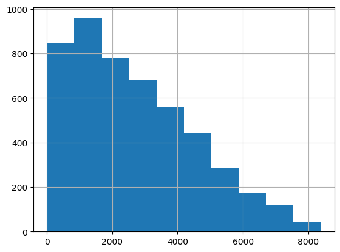
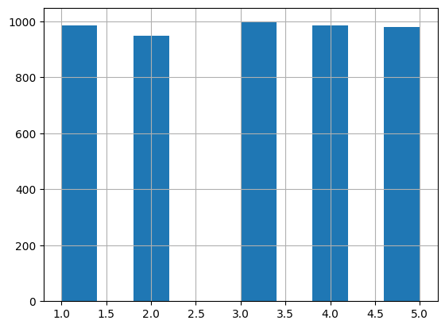
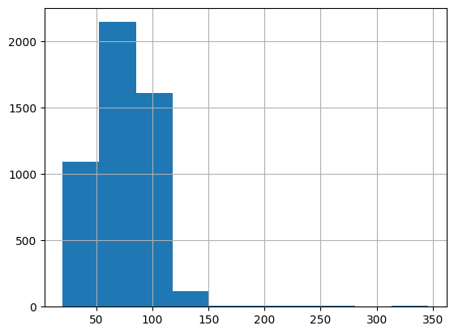
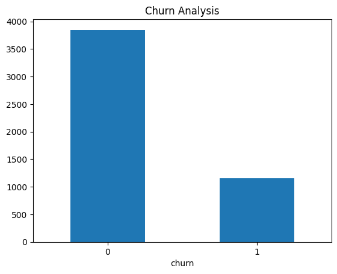
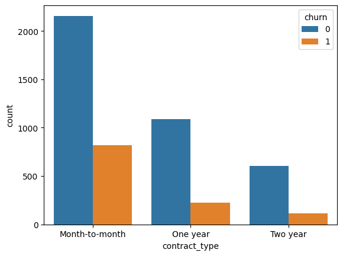
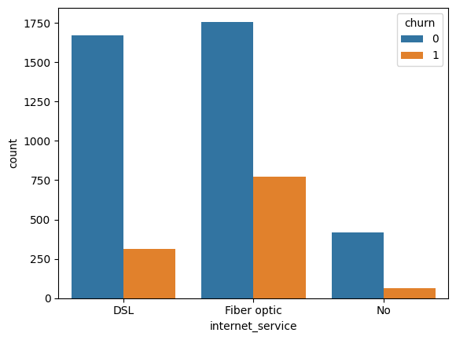
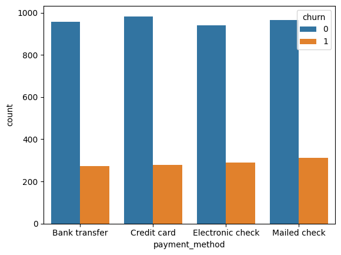
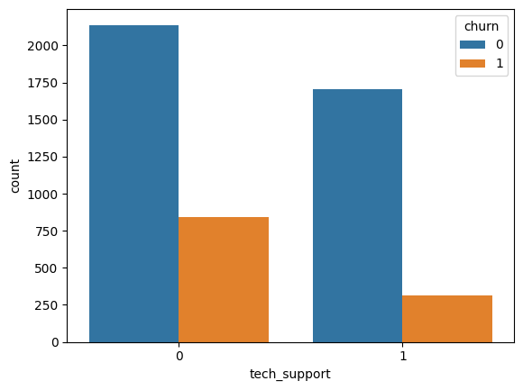
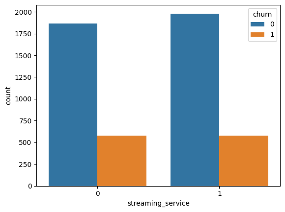
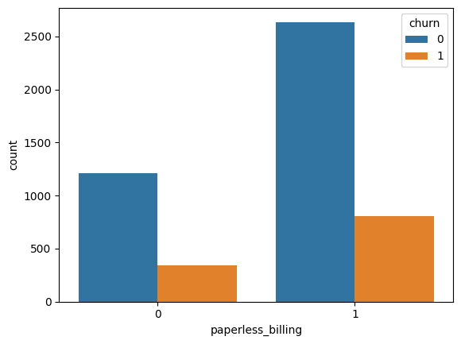

# CUSTOMER CHURN PREDICTION SYSTEM
This project builds a machine learning model to predict customer churn using behavioural, financial, and engagement features.
It identifies key churn drivers and provides insights to support targeted retention strategies and improve customer lifetime value.

## TABLE OF CONTENT
- [Business objective]()
- [Business Context]()
- [Problem Statement]()
- [Dataset Description]()
- [Data Dictionary]()
- [Data Cleaning & Processing]()
- [Exploratory Data Analysis (EDA)]()
- [Feature Engineering]()
- [Encoding, Feature Selection, Train Test Split & Scaling]()
- [Model Development, Model Evaluation/Performance and Tuning]()
- [Key Insights]()
- [Business Recommendations]()
- [Final Executive Summary]()
- [Deployment]()
- [How to Run the Project]()

## BUSINESS OBJECTIVE
The objective of this project is to build a robust churn prediction model that proactively identifies customers at risk of leaving. This enables the business to take data-driven retention actions, minimize revenue loss, and maximize customer lifetime value.

## BUSINESS CONTEXT
This project is situated within the telecommunications industry, where customer retention is a critical driver of profitability and long-term growth. Telecom companies operate in highly competitive markets with low switching costs, making customer churn a persistent challenge.

Customer churn directly impacts revenue, increases customer acquisition costs, and reduces overall customer lifetime value. Retaining existing customers is significantly more cost-effective than acquiring new ones, making churn prediction a high-priority business problem.

By solving this problem, the business can proactively identify at-risk customers, implement targeted retention strategies, and optimize marketing efforts. This leads to reduced revenue loss, improved customer satisfaction, and stronger competitive positioning.

## PROBLEM STATEMENT
This project focuses on predicting customer churn, specifically identifying whether a telecom customer is likely to leave the service or remain.
The target variable is churn, a binary outcome where:
- 1 indicates a customer who has churned
- 0 indicates a customer who has retained their service
This is a supervised binary classification problem, where the goal is to learn patterns from historical customer data to accurately classify future customers as churn or non-churn.

## DATASET DESCRIPTION
The dataset used in this project is a telecom customer churn dataset, designed to simulate real-world customer behaviour in a subscription-based service environment. It contains a mix of demographic, service usage, billing, and customer interaction features.

The dataset consists of 1,000 rows and 13 columns, with each row representing an individual customer and each column capturing specific attributes such as tenure, monthly charges, service subscriptions, and customer satisfaction.

This dataset is structured to support churn prediction by providing both behavioural and transactional data, enabling the model to learn patterns associated with customer retention and attrition.

## DATA DICTIONARY
| Column | Description | Type |
|---|---|---|
| customer_id | Unique customer identifier | String |
| tenure_months | Number of months customer stayed | Integer |
| monthly_charges | Monthly subscription fee | Float |
| total_charges | Total amount paid | Float |
| contract_type | Monthly / One-year / Two-year | Categorical |
| internet_service | DSL / Fiber / None | Categorical |
| tech_support | Has tech support or not | Binary |
| streaming_service | Uses streaming services | Binary |
| payment_method | Payment channel | Categorical |
| paperless_billing | Billing type | Binary |
| satisfaction_score | Customer satisfaction (1–5) | Integer |
| num_support_tickets | Complaints raised | Integer |
| churn | Target variable | Binary |

## DATA CLEANING & PREPROCESSING
**1. Columns Check**

Checked for missing values across all columns to assess data quality. Identified missing entries in total_charges and satisfaction_score, which require handling before modelling.

```Python
#Checking Missing Values
df.isna().sum()
```
| Column | Missing Values |
|---|---:|
| customer_id | 0 |
| tenure_months | 0 |
| monthly_charges | 0 |
| total_charges | 100 |
| contract_type | 0 |
| internet_service | 0 |
| tech_support | 0 |
| streaming_service | 0 |
| payment_method | 0 |
| paperless_billing | 0 |
| satisfaction_score | 100 |
| num_support_tickets | 0 |
| churn | 0 |

**2. Fix total_charges**

Cleaned and validated the total_charges column by handling blanks, converting to numeric, and treating negative values as missing based on business logic. Missing values were then imputed using the median to account for the skewed distribution and preserve data integrity.

```Python
#Step A: Replace blanks
df['total_charges'] = df['total_charges'].replace(" ", np.nan)

#Step B: Convert to numeric
df['total_charges'] = pd.to_numeric(df['total_charges'], errors='coerce')

#Step C: Investigate invalid values
df['total_charges'].describe()
```
| Statistic | total_charges |
|---|---:|
| Count | 4,900 |
| Mean | 2,681.93 |
| Std | 1,855.74 |
| Min | -79.20 |
| 25% (Q1) | 1,157.52 |
| 50% (Median) | 2,360.55 |
| 75% (Q3) | 3,928.41 |
| Max | 8,380.40 |

```Python
#Step D: Fix negatives (business logic)
#In telecom: Total charges should NEVER be negative
df.loc[df['total_charges'] < 0, 'total_charges'] = np.nan
```

What this means logically? “If total_charges is less than 0, treat it as missing data.”

In a telecom churn dataset: Total_charges represent money paid by a customer. Negative charges don’t make business sense (unless it's a refund system, which is rare and should be explicitly modelled)
So negative values are:
- Data entry errors
- ETL issues
- Corrupt records

Why convert to NaN instead of deleting?

I am preserving the row but marking the value as invalid so 1 can later:
- Impute (mean, median, model-based)
- Drop selectively
- Investigate anomalies
Equivalent Plain-English translation: “Find all customers with negative total charges and mark those values as missing because they are invalid.”

```Python
#Checking Missing Values again
df.isna().sum()
```

| Column | Missing Values |
|---|---:|
| customer_id | 0 |
| tenure_months | 0 |
| monthly_charges | 0 |
| total_charges | 113 |
| contract_type | 0 |
| internet_service | 0 |
| tech_support | 0 |
| streaming_service | 0 |
| payment_method | 0 |
| paperless_billing | 0 |
| satisfaction_score | 100 |
| num_support_tickets | 0 |
| churn | 0 |

```Python
#Handle missing values
df['total_charges'].hist()
```


```Python
#Because the distribution above is skewed, I used median to replace the missing values
df['total_charges'].fillna(df['total_charges'].median(), inplace=True)
```

**3.	Handled Missing satisfaction_score**

Handled missing values in satisfaction_score by imputing with the median, as it is an ordinal feature (1–5 scale). This ensures consistency while preserving the inherent ranking structure of the data.

```Python
#Checking the distribution on satisfaction score
df['satisfaction_score'].hist()
```


```Python
#Since it's ordinal (1–5):
#I Imputed with median
df['satisfaction_score'].fillna(df['satisfaction_score'].median(), inplace=True)

#Checked missing values afters fixing them
df.isna().sum()
```
| Column | Missing Values |
|---|---:|
| customer_id | 0 |
| tenure_months | 0 |
| monthly_charges | 0 |
| total_charges | 0 |
| contract_type | 0 |
| internet_service | 0 |
| tech_support | 0 |
| streaming_service | 0 |
| payment_method | 0 |
| paperless_billing | 0 |
| satisfaction_score | 0 |
| num_support_tickets | 0 |
| churn | 0 |

**4.	Fix Data Types**

Converted binary columns to integer format and categorical columns to appropriate category types. This ensures correct data representation and improves efficiency for analysis and model training.

```Python
#Convert binary columns properly
binary_cols = ['tech_support', 'streaming_service', 'paperless_billing', 'churn']
for col in binary_cols:
    df[col] = df[col].astype(int)

#Convert categorical columns
categorical_cols = ['contract_type', 'internet_service', 'payment_method']
for col in categorical_cols:
    df[col] = df[col].astype('category')
```

**5.	Validate Data Integrity**

Validated data integrity by checking for duplicate records in the dataset. No duplicate entries were found, confirming data consistency.

```Python
#Check duplicates
df.duplicated().sum()
#There were no duplicates
```

**6.	Validate logical relationships**

Validated logical relationships by removing records with unrealistic values, such as zero or negative tenure and charges. This ensures the dataset aligns with real-world business rules and improves model reliability.

```Python
#Check unrealistic values
# tenure should be >= 1
df = df[df['tenure_months'] >= 1]
# charges should be positive
df = df[df['monthly_charges'] > 0]
```

**7.	Outlier Detection**

Performed outlier detection by visualizing the distribution of monthly_charges using a histogram. This helps identify extreme values and understand the overall spread of the data before modelling.

```Python
import matplotlib.pyplot as plt
df['monthly_charges'].hist(bins=30)
plt.title("Monthly Charges Distribution")
plt.show()
```


## EXPLORATORY DATA ANALYSIS (EDA)
**1.	Target Variable Analysis (Churn)**

Analysed the distribution of the target variable (churn) to understand class balance. Results show that ~23% of customers churned while ~77% were retained, indicating a moderately imbalanced dataset. The dataset shows a noticeable churn rate (~23%), highlighting a meaningful business risk and the need for targeted retention strategies.

```Python
df['churn'].value_counts(normalize=True)
```
| Churn | Proportion |
|---|---:|
| 0 (No Churn) | 0.7694 (76.94%) |
| 1 (Churn) | 0.2306 (23.06%) |

```Python
import matplotlib.pyplot as plt
df['churn'].value_counts().plot(kind='bar')
plt.title("Churn Distribution")
plt.xticks(rotation=0)
plt.show()
```

 
**2.	Numerical Features vs Churn**

Analysed numerical features against churn to identify key behavioural differences between retained and churned customers. Churned customers tend to have shorter tenure, higher monthly charges, lower satisfaction scores, and more support tickets, indicating dissatisfaction and higher service friction. 

Customers with high monthly costs and frequent support interactions are significantly more likely to churn, making them critical targets for retention strategies.

```python
#Grouped statistics
df.groupby('churn')[[
    'tenure_months',
    'monthly_charges',
    'total_charges',
    'satisfaction_score',
    'num_support_tickets'
]].mean()
```

| Churn | Tenure (Months) | Monthly Charges | Total Charges | Satisfaction Score | Support Tickets |
|---|---:|---:|---:|---:|---:|
| 0 (No Churn) | 37.40 | 73.36 | 2703.48 | 3.17 | 1.36 |
| 1 (Churn) | 30.70 | 84.64 | 2610.04 | 2.44 | 1.99 |

**3.	Categorical Features vs Churn**

Analysed categorical features against churn to uncover patterns in customer behavior. Customers on month-to-month contracts and fiber optic services show higher churn rates, while longer contracts show stronger retention; payment method has a weaker impact, with only slight increases in churn for manual payment options.

Contract type and service usage are the strongest categorical drivers of churn, while payment method plays a minimal role.

```python
#Contract Type
pd.crosstab(df['contract_type'], df['churn'], normalize='index')
```

| Contract Type | No Churn (0) | Churn (1) |
|---|---:|---:|
| Month-to-month | 0.725437 (72.54%) | 0.274563 (27.46%) |
| One year | 0.829641 (82.96%) | 0.170359 (17.04%) |
| Two year | 0.841446 (84.14%) | 0.158554 (15.86%) |

```python
sns.countplot(x='contract_type', hue='churn', data=df)
plt.show()
```


```python
#Internet Service
pd.crosstab(df['internet_service'], df['churn'], normalize='index')
```

| Internet Service | No Churn (0) | Churn (1) |
|---|---:|---:|
| DSL | 0.841470 (84.15%) | 0.158530 (15.85%) |
| Fiber optic | 0.694708 (69.47%) | 0.305292 (30.53%) |
| No Internet Service | 0.864865 (86.49%) | 0.135135 (13.51%) |

```python
sns.countplot(x='internet_service', hue='churn', data=df)
plt.show()
```


```python
#Payment Method
pd.crosstab(df['payment_method'], df['churn'], normalize='index')
```

| Payment Method | No Churn (0) | Churn (1) |
|---|---:|---:|
| Bank transfer | 0.777417 (77.74%) | 0.222583 (22.26%) |
| Credit card | 0.779715 (77.97%) | 0.220285 (22.03%) |
| Electronic check | 0.764419 (76.44%) | 0.235581 (23.56%) |
| Mailed check | 0.756270 (75.63%) | 0.243730 (24.37%) |

```python
sns.countplot(x='payment_method', hue='churn', data=df)
plt.show()
```

 
**4.	Binary Features vs Churn**

Analyzed binary features against churn to identify their impact on customer behavior. Customers without tech support show significantly higher churn, while streaming service and paperless billing have minimal influence.

Lack of tech support is a strong churn indicator, highlighting the importance of customer support in retention.

```python
binary_cols = ['tech_support', 'streaming_service', 'paperless_billing']
for col in binary_cols:
    print(pd.crosstab(df[col], df['churn'], normalize='index'))
```

1. Tech Support

| Tech Support | No Churn (0) | Churn (1) |
|---|---:|---:|
| 0 (No) | 0.718026 (71.80%) | 0.281974 (28.20%) |
| 1 (Yes) | 0.845126 (84.51%) | 0.154874 (15.49%) |

2. Streaming Service

| Streaming Service | No Churn (0) | Churn (1) |
|---|---:|---:|
| 0 (No) | 0.764128 (76.41%) | 0.235872 (23.59%) |
| 1 (Yes) | 0.774433 (77.44%) | 0.225567 (22.56%) |

3. Paperless Billing

| Paperless Billing | No Churn (0) | Churn (1) |
|---|---:|---:|
| 0 (No) | 0.778135 (77.81%) | 0.221865 (22.19%) |
| 1 (Yes) | 0.765457 (76.55%) | 0.234543 (23.45%) |

```python
#Visualizing the above
for col in binary_cols:
    sns.countplot(x=col, hue='churn', data=df)
    plt.show()
```






## FEATURE ENGINEERING
**1.	Customer Lifetime Value (CLV proxy)**

Created a proxy for Customer Lifetime Value (CLV) by calculating the average monthly value per customer using total charges and tenure. This feature helps capture customer value over time and can improve churn prediction by highlighting high- vs low-value customers.

```python
df['avg_monthly_value'] = df['total_charges'] / df['tenure_months']
```

**2.	Charge Intensity**

Created a charge intensity feature by measuring total charges relative to customer support interactions. This helps capture how much value a customer generates per issue raised, providing insight into cost vs service experience.

```python
df['charges_per_ticket'] = df['total_charges'] / (df['num_support_tickets'] + 1)
```

**3.	Engagement Score (Composite Feature)**

Created an engagement score by combining tenure, satisfaction, and support interactions into a single composite metric. This feature captures overall customer engagement, helping the model distinguish between highly engaged and at-risk customers.

```python
df['engagement_score'] = (
    df['tenure_months'] * 0.4 +
    df['satisfaction_score'] * 0.3 -
    df['num_support_tickets'] * 0.3
)
```

**4.	High Risk Customer Flag**
Created a high-risk customer flag by identifying customers with low satisfaction scores and high support ticket counts. This feature helps the model quickly capture customers with strong churn signals based on negative experience indicators.

```python
df['high_risk'] = (
    (df['satisfaction_score'] <= 2) &
    (df['num_support_tickets'] >= 3)
).astype(int)
```

**5.	Tenure Segmentation**

Segmented customers into tenure groups (new, mid, long) based on their subscription duration. This helps capture customer lifecycle stages and improves the model’s ability to detect churn patterns across different tenure levels.

```python
def tenure_group(x):
    if x <= 12:
        return 'new'
    elif x <= 36:
        return 'mid'
    else:
        return 'long'
df['tenure_group'] = df['tenure_months'].apply(tenure_group)
```

## ENCODING, FEATURE SELECTION, TRAIN TEST SPLIT & SCALING
**Encoding Categorical Variables**

Converted categorical variables into numerical format using One-Hot Encoding to make them suitable for machine learning algorithms. Most models cannot interpret non-numeric data directly, so categorical features such as contract type, internet service, payment method, and tenure group were transformed into binary indicator variables. 
The `drop_first=True` parameter was applied to avoid the dummy variable trap (multicollinearity), ensuring that redundant features are removed and the model remains stable and interpretable.

```python
df = pd.get_dummies(df, columns = [
    'contract_type', 'internet_service', 'payment_method', 'tenure_group'
], dtype = int)
```

**Feature Selection Prep**

Prepared the dataset for modeling by removing non-informative features and defining input and target variables. The `customer_id` column was dropped as it serves only as a unique identifier and does not contribute to predicting customer churn. Including such features can introduce noise and negatively impact model performance.

The dataset was then split into features (`x`) and target (`y`), where `x` contains all independent variables and `y` represents the dependent variable (churn). This separation is essential for training machine learning models, as it clearly defines the inputs used for prediction and the outcome to be predicted.

```python
# Dropped unnecessary columns
df = df.drop(columns=['customer_id'])

# Define x and y
x = df.drop('churn', axis=1)
y = df['churn']
```

**Train-Test Split**

Split the dataset into training and testing sets to evaluate model performance on unseen data. An 80/20 split was used, where 80% of the data was allocated for training and 20% for testing. This ensures sufficient data for model learning while retaining a representative portion for evaluation.

The stratify=y parameter was applied to preserve the original distribution of the target variable (churn) in both training and testing sets. This is particularly important for classification problems to prevent class imbalance from skewing results.

A fixed random_state=42 was used to ensure reproducibility, allowing consistent results across multiple runs.
After splitting, the training feature set (X_train) was inspected to confirm that all engineered and encoded features were correctly included, ensuring the dataset is properly structured for model training.

```python
#Train test split
from sklearn.model_selection import train_test_split
x_train, x_test, y_train, y_test = train_test_split(x, y, test_size = 0.2, random_state = 42)
```

**Scaling**

Standardized numerical features to ensure consistent scale across all input variables. Selected continuous variables such as tenure, charges, satisfaction score, and engineered features were scaled using `StandardScaler`, which transforms data to have a mean of 0 and a standard deviation of 1. 

The scaler was fitted only on the training data and then applied to both training and testing sets. This prevents data leakage, ensuring that information from the test set does not influence the training process.

Feature scaling is particularly important for models that rely on distance or gradient-based optimization, as it ensures that no single feature disproportionately influences the model due to its scale.

```python
#Define columns to scale
num_cols = [
   'monthly_charges', 'total_charges', 'satisfaction_score', 'avg_monthly_value',
    'num_support_tickets', 'charges_per_ticket', 'engagement_score', 'tenure_months'
]

#scale the column above using standard scalar
from sklearn.preprocessing import StandardScaler
scaler = StandardScaler()
x_train[num_cols] = scaler.fit_transform(x_train[num_cols])
x_test[num_cols] = scaler.transform(x_test[num_cols])
```

MODEL DEVELOPMENT AND EVALAUTION
Logistic Regression (Baseline Model)
Logistic Regression was selected as the baseline classification model to predict whether a customer will churn or remain with the company. It provides a simple, interpretable approach for binary classification. The class_weight='balanced' parameter was used to address the imbalance in the target variable, where non-churning customers make up approximately 77% of the dataset and churning customers account for 23%.
#Building model
from sklearn.linear_model import LogisticRegression
log_model = LogisticRegression(
    class_weight='balanced',
    max_iter=1000
)
log_model.fit(x_train, y_train)

#predict x test
log_pred = log_model.predict(x_test)

#Evaluate model
from sklearn.metrics import confusion_matrix, accuracy_score, precision_score, recall_score, f1_score
print('confusion_matrix:\n', confusion_matrix(y_test, log_pred))
print('accuracy_score:', accuracy_score(y_test, log_pred))
print('precision_score:', precision_score(y_test, log_pred))
print('recall_score:', recall_score(y_test, log_pred))
print('f1_score:', f1_score(y_test, log_pred))
Result:
confusion_matrix:
 [[563 202]
 [ 80 155]]
accuracy_score: 0.718
precision_score: 0.4341736694677871
recall_score: 0.6595744680851063
f1_score: 0.5236486486486487

#roc_auc_score
from sklearn.metrics import roc_auc_score, roc_curve
log_probs = log_model.predict_proba(x_test)[:, 1]
print('roc_auc_score:', roc_auc_score(y_test, log_probs))
Result:
roc_auc_score: 0.7702405785009039

Results Summary: The model achieved an accuracy of 71.8%, a precision of 43.42%, a recall of 65.96%, an F1-score of 52.36%, and a ROC-AUC score of 0.7702. The model correctly identified 155 out of 235 customers who churned, while missing 80 actual churners. Its recall indicates that it identified approximately 66% of actual churners, while its precision shows that some customers predicted to churn did not actually churn. The ROC-AUC score suggests a reasonable ability to distinguish between customers who churn and those who remain.
These results establish a baseline for evaluating and comparing the performance of other classification models.

Random Forest Model
Random Forest was selected to evaluate whether an ensemble of decision trees could improve churn prediction by capturing complex relationships and interactions among customer features. The model was configured with 100 decision trees, while class_weight='balanced' was used to account for the imbalance between churn and non-churn customers. The random_state=42 parameter ensures reproducibility.
#Building Model
from sklearn.ensemble import RandomForestClassifier
rf_model = RandomForestClassifier(
    class_weight='balanced',
    n_estimators=100,
    random_state=42
)
rf_model.fit(x_train, y_train)

#predict for x test
rf_pred = rf_model.predict(x_test)

#Evaluate model
from sklearn.metrics import confusion_matrix, accuracy_score, precision_score, recall_score, f1_score
print('confusion_matrix:\n', confusion_matrix(y_test, rf_pred))
print('accuracy_score:', accuracy_score(y_test, rf_pred))
print('precision_score', precision_score(y_test, rf_pred))
print('recall_score:', recall_score(y_test, rf_pred))
print('f1_score:', f1_score(y_test, rf_pred))
Result:
confusion_matrix:
 [[707  58]
 [189  46]]
accuracy_score: 0.753
precision_score 0.4423076923076923
recall_score: 0.19574468085106383
f1_score: 0.2713864306784661

#roc_auc_score
from sklearn.metrics import roc_auc_score, roc_curve
rf_probs = rf_model.predict_proba(x_test)[:, 1]
print('roc_auc_score:', roc_auc_score(y_test, rf_probs))
Result:
roc_auc_score: 0.7222945348352108

Results Summary: The model achieved an accuracy of 75.3%, a precision of 44.23%, a recall of 19.57%, an F1-score of 27.14%, and a ROC-AUC score of 0.7223. It correctly identified 46 out of 235 customers who churned, missing 189 actual churners. Although the model achieved a higher accuracy than the Logistic Regression baseline, its low recall indicates that it failed to identify most customers who churned. Its ROC-AUC score also suggests weaker overall discrimination between churners and non-churners than the baseline model.
These results highlight the importance of evaluating multiple classification metrics rather than relying on accuracy alone, particularly when identifying customers at risk of churn is a key business objective.

XGBoost (High-Performance Model)
XGBoost was selected as a gradient-boosting classification model to evaluate whether sequentially combining decision trees could improve customer churn prediction. The scale_pos_weight=3.34 parameter was used to give greater importance to the minority churn class, while eval_metric='logloss' specified the evaluation metric used during training. The random_state=42 parameter ensures reproducibility.
#Building Model
from xgboost import XGBClassifier
xgb_model = XGBClassifier(
    scale_pos_weight=3.34,
    eval_metric='logloss',
    random_state=42
)
xgb_model.fit(x_train, y_train)

#predict for x test
xgb_pred = xgb_model.predict(x_test)

#Evaluate model
from sklearn.metrics import confusion_matrix, accuracy_score, precision_score, recall_score, f1_score
print('confusion_matrix:\n', confusion_matrix(y_test, xgb_pred))
print('accuracy_score:', accuracy_score(y_test, xgb_pred))
print('precision_score', precision_score(y_test, xgb_pred))
print('recall_score', recall_score(y_test, xgb_pred))
print('f1_score:', f1_score(y_test, xgb_pred))
Result:
confusion_matrix:
 [[616 149]
 [123 112]]
accuracy_score: 0.728
precision_score 0.42911877394636017
recall_score 0.4765957446808511
f1_score: 0.45161290322580644

#roc_auc_score
from sklearn.metrics import roc_auc_score, roc_curve
xgb_probs = xgb_model.predict_proba(x_test)[:, 1]
print('roc_auc_score:', roc_auc_score(y_test, xgb_probs))
Result:
roc_auc_score: 0.7397079682937004

Results Summary: The model achieved an accuracy of 72.8%, a precision of 42.91%, a recall of 47.66%, an F1-score of 45.16%, and a ROC-AUC score of 0.7397. It correctly identified 112 out of 235 customers who churned, while missing 123 actual churners. Compared with the Random Forest model, XGBoost achieved substantially higher recall and F1-score, identifying more customers at risk of churn. However, its performance remained below the Logistic Regression baseline in recall, F1-score, and ROC-AUC.
These results suggest that XGBoost offers a better balance between precision and recall than the Random Forest model in this configuration, although further evaluation is needed to determine the most suitable model for the business objective.

MODEL EVALUATION
Model	Accuracy	Precision	Recall	F1-score	ROC-AUC
Logistic Regression	71.80%	43.42%	65.96%	52.36%	0.7702
Random Forest	75.30%	44.23%	19.57%	27.14%	0.7223
XGBoost	72.80%	42.91%	47.66%	45.16%	0.7397

The initial evaluation compared Logistic Regression, Random Forest, and XGBoost using accuracy, precision, recall, F1-score, and ROC-AUC. Since the primary objective is to identify customers at risk of churning, particular attention was given to recall and F1-score rather than accuracy alone.
Among the three models, Logistic Regression was selected for further tuning because it achieved the highest recall (65.96%), F1-score (52.36%), and ROC-AUC (0.7702). Although Random Forest recorded the highest accuracy (75.3%), its recall of 19.57% indicates that it missed most actual churners. XGBoost performed better than Random Forest in identifying churners, achieving a recall of 47.66% and an F1-score of 45.16%, but it did not outperform Logistic Regression on the key evaluation metrics.
Logistic Regression therefore provided the strongest initial balance of churn detection and overall classification performance. Its ROC-AUC score also indicated better discrimination between churners and non-churners than the other two models. Consequently, it was selected as the preferred baseline model for further hyperparameter tuning and decision-threshold evaluation to improve its predictive performance.

Tuning Logistic Regression's C parameter
The Logistic Regression model was further tuned by testing different values of the regularization parameter C: 0.1, 1.0, and 10.0. The purpose was to determine how the strength of regularization affects the model's ability to identify customers likely to churn. A smaller C applies stronger regularization, while a larger C applies weaker regularization. The model retained class_weight='balanced' to account for the imbalance in the target variable.
#Tuning
from sklearn.linear_model import LogisticRegression
for c in [0.1, 1.0, 10.0]:
    log_model = LogisticRegression(
        class_weight='balanced',
        C=c,
        max_iter=1000,
        random_state=42
    )
    log_model.fit(x_train, y_train)
    y_pred = log_model.predict(x_test)
    y_probs = log_model.predict_proba(x_test)[:, 1]
    print(f"\nC = {c}")
    print("Recall:", recall_score(y_test, y_pred))
    print("Precision:", precision_score(y_test, y_pred, zero_division=0))
    print("F1-score:", f1_score(y_test, y_pred, zero_division=0))
    print("ROC-AUC:", roc_auc_score(y_test, y_probs))
Result:
C = 0.1
Recall: 0.6638297872340425
Precision: 0.43333333333333335
F1-score: 0.5243697478991597
ROC-AUC: 0.769979140592407

C = 1.0
Recall: 0.6595744680851063
Precision: 0.4341736694677871
F1-score: 0.5236486486486487
ROC-AUC: 0.7702405785009039

C = 10.0
Recall: 0.6638297872340425
Precision: 0.43575418994413406
F1-score: 0.5261382799325464
ROC-AUC: 0.7703073286052009

Results Summary: Among the three configurations, C=10.0 produced the best overall results, achieving a recall of 66.38%, precision of 43.58%, F1-score of 52.61%, and ROC-AUC of 0.7703. It achieved the highest F1-score and ROC-AUC, while its recall matched that of C=0.1. However, the improvements were marginal, indicating that adjusting C alone had a limited effect on model performance.
Therefore, C=10.0 was selected as the preferred configuration for the next stage of evaluation, which involved experimenting with the classification decision threshold to improve churn detection.

Testing Threshold
After selecting C=10.0 for Logistic Regression, different classification thresholds were tested to determine how the decision boundary affects the model's ability to identify customers likely to churn. The default threshold of 0.5 was compared with lower thresholds of 0.4, 0.3, and 0.2. An additional threshold of 0.45 was evaluated to find a more suitable balance between precision and recall.
# Testing a lower threshold
from sklearn.linear_model import LogisticRegression
from sklearn.metrics import (
    precision_score,
    recall_score,
    f1_score,
    confusion_matrix
)
log_model = LogisticRegression(
    class_weight='balanced',
    C=10.0,
    max_iter=1000,
    random_state=42
)
log_model.fit(x_train, y_train)

# Get predicted probabilities
y_probs = log_model.predict_proba(x_test)[:, 1]

# Test different classification thresholds
for threshold in [0.5, 0.4, 0.3, 0.2]:

    y_pred = (y_probs >= threshold).astype(int)
    print(f"\nThreshold: {threshold}")
    print("Confusion Matrix:\n", confusion_matrix(y_test, y_pred))
    print("Precision:", precision_score(y_test, y_pred, zero_division=0))
    print("Recall:", recall_score(y_test, y_pred, zero_division=0))
    print("F1-score:", f1_score(y_test, y_pred, zero_division=0))
Result:
Threshold: 0.5
Confusion Matrix:
 [[563 202]
 [ 79 156]]
Precision: 0.43575418994413406
Recall: 0.6638297872340425
F1-score: 0.5261382799325464

Threshold: 0.4
Confusion Matrix:
 [[459 306]
 [ 49 186]]
Precision: 0.3780487804878049
Recall: 0.7914893617021277
F1-score: 0.5116918844566712

Threshold: 0.3
Confusion Matrix:
 [[353 412]
 [ 22 213]]
Precision: 0.3408
Recall: 0.9063829787234042
F1-score: 0.49534883720930234

Threshold: 0.2
Confusion Matrix:
 [[216 549]
 [  3 232]]
Precision: 0.2970550576184379
Recall: 0.9872340425531915
F1-score: 0.4566929133858268

# threshold = 0.45
threshold = 0.45
y_pred = (y_probs >= threshold).astype(int)
print("Confusion Matrix:\n", confusion_matrix(y_test, y_pred))
print("Precision:", precision_score(y_test, y_pred, zero_division=0))
print("Recall:", recall_score(y_test, y_pred, zero_division=0))
print("F1-score:", f1_score(y_test, y_pred, zero_division=0))
Result:
Confusion Matrix:
 [[511 254]
 [ 58 177]]
Precision: 0.41067285382830626
Recall: 0.7531914893617021
F1-score: 0.5315315315315315

Results Summary: Lowering the classification threshold increased recall but reduced precision. At the default threshold of 0.5, the model achieved a recall of 66.38% and an F1-score of 52.61%. At a threshold of 0.2, recall increased to 98.72%, but precision fell to 29.71%, meaning many customers flagged as potential churners did not actually churn.
The threshold of 0.45 produced the highest F1-score of 53.15%, with a precision of 41.07% and a recall of 75.32%. At this threshold, the model correctly identified 177 of the 235 actual churners, compared with 156 at the default threshold. Although this improvement came with more false-positive predictions, it provided a better balance between precision and recall among the tested thresholds.
Therefore, 0.45 was selected as the current candidate threshold because it improved churn detection while maintaining a stronger F1-score than the other tested thresholds. The final choice should ultimately reflect the business cost of missed churners versus unnecessary retention interventions.

KEY INSIGHTS
1.	Class Imbalance: The dataset contains approximately 77% non-churning customers and 23% churning customers.
This imbalance makes it important to evaluate models using precision, recall, F1-score, and ROC-AUC rather than relying on accuracy alone.
2.	Logistic Regression Performed Best Initially: Among the three baseline models, Logistic Regression achieved the
highest recall (65.96%), F1-score (52.36%), and ROC-AUC (0.7702). It was therefore selected for further tuning.
3.	Random Forest Had Weak Churn Detection: Although Random Forest recorded the highest baseline accuracy
(75.30%), its recall was only 19.57%. This means it failed to identify most customers who actually churned, making it less suitable for the primary business objective.
4.	XGBoost Improved on Random Forest: XGBoost achieved a recall of 47.66% and an F1-score of 45.16%, 
outperforming Random Forest in identifying churners. However, it did not outperform Logistic Regression on the key evaluation metrics.
5.	Regularization Tuning Produced Marginal Improvements: Testing different values of the Logistic Regression C 
parameter showed that C=10.0 achieved the best F1-score (52.61%) and ROC-AUC (0.7703). However, the improvements over the initial configuration were relatively small.
6.	Classification Threshold Affected Churn Detection: Lowering the classification threshold increased the model's 
recall because more customers were classified as potential churners. However, this also increased false-positive predictions and reduced precision.
7.	Threshold 0.45 Provided the Best Balance Among Tested Thresholds: At this threshold, the model achieved a 
precision of 41.07%, recall of 75.32%, and F1-score of 53.15%. It correctly identified 177 out of 235 actual churners, compared with 156 at the default threshold of 0.5.
8.	Business Objective Remains Central: Since the main objective is to identify as many potential churners as possible, 
recall is an important performance metric. However, precision must also be considered to ensure that retention resources are not wasted on too many customers who would otherwise remain.

Overall Finding
Logistic Regression emerged as the strongest candidate among the baseline models and showed further improvement after regularization and threshold tuning. The configuration with C=10.0 and a classification threshold of 0.45 currently provides the best balance of precision and recall among the tested configurations. It is therefore the preferred candidate for further evaluation and potential deployment.

BUSINESS RECOMMENDATIONS
Based on the customer churn prediction analysis and the model evaluation results, the following business recommendations are proposed to help reduce customer attrition, improve customer retention, and support data-driven decision-making.
1.	Implement a Proactive Customer Retention Strategy
The business should use the churn prediction model to identify customers who are likely to leave before they actually churn. Rather than waiting for customers to cancel their subscriptions, the company should proactively reach out to high-risk customers with appropriate retention offers and support.
2.	Prioritize High-Risk Customers
Customers flagged as potential churners should be prioritized for retention campaigns. Since the selected threshold of 0.45 achieved a recall of 75.32%, the model identified 177 out of 235 actual churners in the test set. This demonstrates its potential to support early identification and intervention
3.	Investigate Customer Dissatisfaction
The business should regularly monitor customer satisfaction scores, complaints, and support tickets. Customers experiencing repeated service issues or low satisfaction should receive timely assistance to address their concerns before they decide to leave.
4.	Review Pricing and Customer Spending
The business should examine the relationship between monthly charges, total charges, and customer churn. Where pricing or perceived value may be contributing to dissatisfaction, management should consider flexible subscription plans, targeted discounts, and packages that better match customers' needs.
5.	Develop Targeted Retention Campaigns
Instead of applying the same retention strategy to every customer, the business should tailor interventions according to individual risk levels and customer characteristics. Possible interventions include loyalty rewards, personalized offers, improved customer support, and subscription upgrades or adjustments.
6.	Strengthen Customer Engagement
The company should establish regular communication with customers through follow-up calls, emails, surveys, and personalized service recommendations. Consistent engagement can help identify dissatisfaction early and improve the overall customer experience.
7.	Monitor Model Performance Regularly
The churn prediction model should be evaluated periodically using metrics such as recall, precision, F1-score, and ROC-AUC. Since customer behaviour may change over time, the model should be retrained when necessary to maintain its predictive performance.
8.	Measure the Effectiveness of Retention Campaigns
The business should track the outcomes of retention interventions by monitoring how many flagged customers remain active after receiving support or offers. This will help determine whether the retention strategies are effective and whether the financial benefits justify their costs.

Expected Business Impact
•	Implementing these recommendations can help the business:
•	Reduce customer attrition and improve retention rates.
•	Identify potential churners earlier.
•	Improve customer satisfaction and loyalty.
•	Allocate retention resources more effectively.
•	Reduce revenue losses associated with customer churn.
•	Use predictive analytics to support strategic business decisions.

Overall Recommendation: The business should adopt a proactive, data-driven customer retention strategy by integrating the churn prediction model into its customer management process. The model should serve as a decision-support tool, helping management identify at-risk customers and prioritize appropriate retention actions rather than automatically determining which customers receive interventions.
Important: These are proposed business actions based on your modelling results. Their actual impact on churn reduction should be measured after implementation.

FINAL EXECUTE SUMMARY
This project focused on developing a Customer Churn Prediction System using machine learning to identify customers who are likely to leave a business. The objective was to uncover churn patterns, build a predictive model, and provide actionable insights to support customer retention.
After data cleaning, preprocessing, and feature engineering, three classification models were evaluated: Logistic Regression, Random Forest, and XGBoost. Logistic Regression emerged as the best baseline model and was selected for further tuning.
After testing different regularization strengths and classification thresholds, the Logistic Regression model with C=10.0 and a threshold of 0.45 achieved a precision of 41.07%, recall of 75.32%, and F1-score of 53.15%. It successfully identified 177 out of 235 actual churners in the test dataset.
The findings demonstrate the potential of machine learning to support proactive customer retention. Recommendations include prioritizing high-risk customers, improving customer satisfaction, developing targeted retention strategies, and monitoring model performance regularly.
Overall, the project provides a foundation for data-driven customer retention decisions, helping businesses identify potential churners early and reduce revenue losses associated with customer attrition.

DEPLOYMENT
Deployed the trained churn prediction model using a Streamlit web application to enable interactive and user-friendly access.
The deployment integrates the trained Logistic Regression model with preprocessing components, including feature scaling and encoding, ensuring consistency between training and real-time predictions.
Users can input customer details through the interface, and the application processes the data, applies the same transformations used during model training, and generates a churn prediction along with the associated probability.
This deployment allows non-technical stakeholders to easily assess customer churn risk in real time, supporting data-driven decision-making and proactive retention strategies.
Overall, the Streamlit application serves as a lightweight and effective solution for operationalizing the machine learning model in a business environment.

App Scripts
import streamlit as st
import pandas as pd
import numpy as np
import joblib
from pathlib import Path

# ============================================================
# 1. PAGE CONFIGURATION
# ============================================================

st.set_page_config(
    page_title="Customer Churn Prediction",
    page_icon="📊",
    layout="wide"
)

# ============================================================
# 2. FILE PATHS AND MODEL CONFIGURATION
# ============================================================

BASE_DIR = Path(__file__).resolve().parent

MODEL_PATH = BASE_DIR / "churn_model.pkl"
SCALER_PATH = BASE_DIR / "scaler.pkl"
FEATURE_COLUMNS_PATH = BASE_DIR / "feature_columns.pkl"

THRESHOLD = 0.45

NUM_COLS = [
    "monthly_charges",
    "total_charges",
    "satisfaction_score",
    "avg_monthly_value",
    "num_support_tickets",
    "charges_per_ticket",
    "engagement_score",
    "tenure_months"
]

ENGINEERED_FEATURES = [
    "avg_monthly_value",
    "charges_per_ticket",
    "engagement_score",
    "high_risk"
]

CATEGORICAL_PREFIXES = [
    "contract_type",
    "internet_service",
    "payment_method",
    "tenure_group"
]

# ============================================================
# 3. LOAD THE SAVED ARTIFACTS
# ============================================================

@st.cache_resource
def load_artifacts():
    model = joblib.load(MODEL_PATH)
    scaler = joblib.load(SCALER_PATH)
    feature_columns = joblib.load(FEATURE_COLUMNS_PATH)

    return model, scaler, feature_columns

st.title("📊 Customer Churn Prediction System")

st.write(
    "Enter a customer's information to estimate the probability "
    "that the customer will churn."
)

st.caption(
    "Model: Logistic Regression | "
    f"Classification threshold: {THRESHOLD:.2f}"
)

try:
    model, scaler, feature_columns = load_artifacts()

except FileNotFoundError as error:
    st.error(
        f"Required model file not found: {error.filename}. "
        "Place all three model files in the same folder as app.py."
    )
    st.stop()

except Exception as error:
    st.error(f"Could not load model artifacts: {error}")
    st.stop()

feature_columns = list(feature_columns)

if not hasattr(model, "predict_proba"):
    st.error("The saved model does not support predict_proba().")
    st.stop()

if not hasattr(scaler, "n_features_in_"):
    st.error("The saved scaler has not been fitted.")
    st.stop()

if len(NUM_COLS) != scaler.n_features_in_:
    st.error(
        "NUM_COLS does not match the number of columns "
        "used to fit the saved scaler."
    )
    st.stop()

missing_numeric_columns = [
    col for col in NUM_COLS if col not in feature_columns
]

if missing_numeric_columns:
    st.error(
        f"Missing numerical model columns: {missing_numeric_columns}"
    )
    st.stop()

# ============================================================
# 4. IDENTIFY CATEGORICAL OPTIONS
# ============================================================

def get_category_options(prefix):
    options = []

    for column in feature_columns:
        if column.startswith(prefix + "_"):
            category = column[len(prefix) + 1:]
            options.append(category)

    return options

category_options = {
    prefix: get_category_options(prefix)
    for prefix in CATEGORICAL_PREFIXES
}

missing_categories = [
    prefix for prefix, options in category_options.items()
    if not options
]

if missing_categories:
    st.error(
        "Could not identify categories for: "
        f"{missing_categories}. Check feature_columns.pkl."
    )
    st.stop()

# ============================================================
# 5. IDENTIFY ADDITIONAL FEATURES
# ============================================================

def is_encoded_column(column):
    return any(
        column.startswith(prefix + "_")
        for prefix in CATEGORICAL_PREFIXES
    )


handled_columns = (
    set(NUM_COLS)
    | set(ENGINEERED_FEATURES)
    | {
        f"{prefix}_{category}"
        for prefix, options in category_options.items()
        for category in options
    }
)

# These include the original binary columns, such as
# tech_support, streaming_service, and paperless_billing.
extra_features = [
    col for col in feature_columns
    if col not in handled_columns
    and not is_encoded_column(col)
    and col not in ["customer_id", "churn"]
]

# ============================================================
# 6. CUSTOMER INPUT FORM
# ============================================================

st.subheader("Customer Information")

with st.form("churn_prediction_form"):

    col1, col2 = st.columns(2)

    with col1:
        tenure_months = st.number_input(
            "Tenure (months)",
            min_value=1,
            max_value=120,
            value=12,
            step=1
        )

        monthly_charges = st.number_input(
            "Monthly Charges",
            min_value=0.01,
            value=75.0,
            step=1.0
        )

        total_charges = st.number_input(
            "Total Charges",
            min_value=0.0,
            value=900.0,
            step=10.0
        )

        satisfaction_score = st.number_input(
            "Satisfaction Score",
            min_value=1,
            max_value=5,
            value=3,
            step=1
        )

    with col2:
        num_support_tickets = st.number_input(
            "Number of Support Tickets",
            min_value=0,
            max_value=1000,
            value=2,
            step=1
        )

        contract_type = st.selectbox(
            "Contract Type",
            options=category_options["contract_type"]
        )

        internet_service = st.selectbox(
            "Internet Service",
            options=category_options["internet_service"]
        )

        payment_method = st.selectbox(
            "Payment Method",
            options=category_options["payment_method"]
        )

    # --------------------------------------------------------
    # BINARY FEATURES: YES = 1, NO = 0
    # --------------------------------------------------------

    st.markdown("### Additional Customer Services")

    binary_features = [
        "tech_support",
        "streaming_service",
        "paperless_billing"
    ]

    binary_values = {}

    binary_labels = {
        "tech_support": "Tech Support",
        "streaming_service": "Streaming Service",
        "paperless_billing": "Paperless Billing"
    }

    for feature in binary_features:

        # Only display features that exist in the trained model.
        if feature in feature_columns:

            answer = st.selectbox(
                binary_labels[feature],
                options=["Yes", "No"],
                key=feature
            )

            binary_values[feature] = (
                1 if answer == "Yes" else 0
            )

    # --------------------------------------------------------
    # OTHER FEATURES PRESENT IN THE MODEL
    # --------------------------------------------------------

    extra_values = {}

    remaining_features = [
        feature for feature in extra_features
        if feature not in binary_features
    ]

    if remaining_features:

        st.markdown("### Other Model Features")

        st.caption(
            "These additional predictors are present in your "
            "saved model. Enter their values using the same "
            "encoding and definitions as the training dataset."
        )

        extra_columns = st.columns(2)

        for index, feature in enumerate(remaining_features):

            with extra_columns[index % 2]:

                extra_values[feature] = st.number_input(
                    feature.replace("_", " ").title(),
                    value=0.0,
                    key=f"extra_{feature}"
                )

    submitted = st.form_submit_button(
        "Predict Customer Churn",
        type="primary",
        use_container_width=True
    )

# ============================================================
# 7. FEATURE ENGINEERING
# ============================================================

if submitted:

    avg_monthly_value = (
        total_charges / tenure_months
    )

    charges_per_ticket = (
        monthly_charges / (num_support_tickets + 1)
    )

    engagement_score = (
        tenure_months * 0.4
        + satisfaction_score * 0.3
        - num_support_tickets * 0.3
    )

    high_risk = int(
        satisfaction_score <= 2
        and num_support_tickets >= 3
    )

    if tenure_months <= 12:
        tenure_group = "new"
    elif tenure_months <= 36:
        tenure_group = "mid"
    else:
        tenure_group = "old"

    # ========================================================
    # 8. CREATE MODEL INPUT
    # ========================================================

    input_df = pd.DataFrame(
        np.zeros((1, len(feature_columns))),
        columns=feature_columns
    )

    input_values = {
        "monthly_charges": monthly_charges,
        "total_charges": total_charges,
        "satisfaction_score": satisfaction_score,
        "num_support_tickets": num_support_tickets,
        "tenure_months": tenure_months,
        "avg_monthly_value": avg_monthly_value,
        "charges_per_ticket": charges_per_ticket,
        "engagement_score": engagement_score,
        "high_risk": high_risk
    }

    # Add original numerical and engineered features.
    for column, value in input_values.items():
        if column in input_df.columns:
            input_df.loc[0, column] = value

    # Add binary features directly as 1 or 0.
    # Do not one-hot encode these columns.
    for column, value in binary_values.items():
        input_df.loc[0, column] = value

    # Add any other original predictors.
    for column, value in extra_values.items():
        if column in input_df.columns:
            input_df.loc[0, column] = value

    # Set the selected one-hot encoded categories.
    selected_categories = {
        "contract_type": contract_type,
        "internet_service": internet_service,
        "payment_method": payment_method,
        "tenure_group": tenure_group
    }

    for prefix, category in selected_categories.items():

        encoded_column = f"{prefix}_{category}"

        if encoded_column not in input_df.columns:
            st.error(
                f"Expected feature '{encoded_column}' was not found "
                "in feature_columns.pkl."
            )
            st.stop()

        input_df.loc[0, encoded_column] = 1

    # ========================================================
    # 9. SCALE NUMERICAL FEATURES ONLY
    # ========================================================

    try:
        input_df.loc[:, NUM_COLS] = scaler.transform(
            input_df[NUM_COLS]
        )

    except Exception as error:
        st.error(f"Scaling failed: {error}")
        st.stop()

    # Preserve the exact feature order used during training.
    input_df = input_df[feature_columns]


    # ========================================================
    # 10. PREDICTION
    # ========================================================

    try:
        probabilities = model.predict_proba(input_df)[0]

        class_labels = list(model.classes_)

        if 1 not in class_labels:
            st.error(
                "Class 1 was not found in the model. "
                "Check your churn target encoding."
            )
            st.stop()

        churn_index = class_labels.index(1)

        churn_probability = float(
            probabilities[churn_index]
        )

        prediction = int(
            churn_probability >= THRESHOLD
        )

    except Exception as error:
        st.error(f"Prediction failed: {error}")
        st.stop()

    # ========================================================
    # 11. DISPLAY RESULTS
    # ========================================================

    st.divider()
    st.subheader("Prediction Results")

    result_col1, result_col2 = st.columns(2)

    with result_col1:
        st.metric(
            "Churn Probability",
            f"{churn_probability:.1%}"
        )

    with result_col2:
        st.metric(
            "Classification Threshold",
            f"{THRESHOLD:.0%}"
        )

    st.progress(churn_probability)

    if prediction == 1:

        st.error(
            "⚠️ High Churn Risk: The model predicts that "
            "this customer is likely to churn."
        )

        st.write(
            "Recommended action: Review customer satisfaction, "
            "support history, contract type, and service experience. "
            "Consider a targeted retention intervention."
        )

    else:

        st.success(
            "✅ Lower Churn Risk: The customer is not classified "
            "as likely to churn at the selected threshold."
        )

        st.write(
            "Recommended action: Continue monitoring customer "
            "engagement and satisfaction."
        )

    st.caption(
        "This is a model-based estimate, not a guarantee of "
        "future customer behaviour."
    )

    # --------------------------------------------------------
    # ENGINEERED FEATURES
    # --------------------------------------------------------

    with st.expander("View Engineered Features"):

        engineered_df = pd.DataFrame({
            "Feature": [
                "Average Monthly Value",
                "Charges Per Ticket",
                "Engagement Score",
                "High Risk Flag",
                "Tenure Group"
            ],
            "Value": [
                round(avg_monthly_value, 3),
                round(charges_per_ticket, 3),
                round(engagement_score, 3),
                high_risk,
                tenure_group
            ]
        })

        st.dataframe(
            engineered_df,
            hide_index=True,
            use_container_width=True
        )

    # --------------------------------------------------------
    # PROCESSED MODEL INPUT
    # --------------------------------------------------------

    with st.expander("View Processed Model Input"):

        st.dataframe(
            input_df,
            hide_index=True,
            use_container_width=True
        )

HOW TO RUN THE PROJECT
The Telecommunication Customer Churn Prediction System is deployed using Streamlit Cloud and can be accessed directly through the application link below:
Application Link:
telecommunication-churn-prediction-system.streamlit.app
Users can open the link in any web browser to interact with the churn prediction application. No local installation or additional setup is required.
The application allows users to input customer information and receive a churn prediction result generated by the trained machine learning model.


